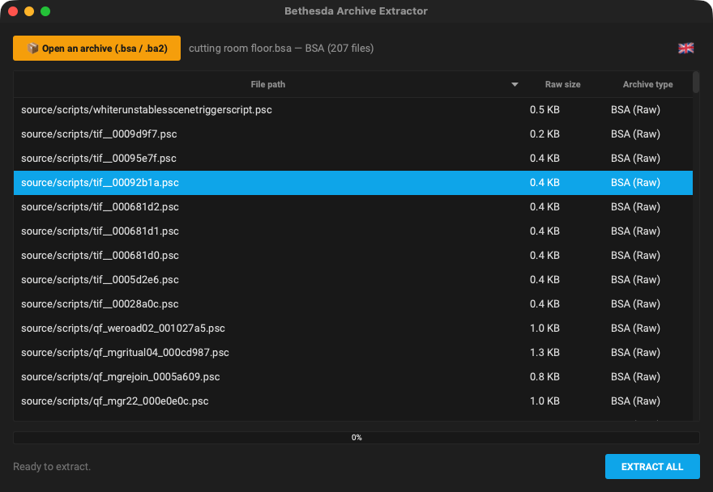

# BAE

**Bethesda Archive Extractor: open and extract .bsa and .ba2 archives on macOS.**  
*Bethesda Archive Extractor : ouvrir et extraire les archives .bsa et .ba2 sur macOS.*

🇬🇧 [English](#-english) · 🇫🇷 [Français](#-français)

---
## 🇬🇧 English

### What it does

BAE lists the content of Bethesda archives (Skyrim .bsa, Fallout 4 / Starfield .ba2) and extracts them to a folder of your choice, handling zlib and LZ4 compression.

### Features

- Reads **BSA** (Skyrim SE) and **BA2** archives.
- File list with path, size and compression; sortable columns.
- **Extract all** to a destination folder, with progress bar; folder structure preserved.
- Drag and drop an archive anywhere on the window.
- Interface in **English, French, Italian and Spanish** (follows your Mac's language; can be changed in the app).

### What's new in 1.0.1


### Updates

From version 1.0.1 the app checks once a day whether a newer release exists on GitHub and offers to open the Nexus page, remind you later or skip that version. Nothing is downloaded or installed automatically. The full history is in [CHANGELOG.md](CHANGELOG.md).

### Screenshots


*Content of a BSA archive*

### Requirements

A Mac with **Apple Silicon** (M1 or later), **macOS 13 Ventura** or later. No Python, no Wine, no virtual machine needed.

### Installation

1. Download the zip from Nexus Mods (or from the GitHub releases) and unzip it.
2. Move **BAE.app** to your **Applications** folder.

### How to use

1. Drop an archive on the window or click **Open an archive**.
2. Check the content, then click **EXTRACT ALL** and choose the destination folder.

### FAQ

**Can BAE create archives?**  
No, BAE only reads and extracts.

### Building from source

Requires Python 3.12 with PyQt6 and PyInstaller. From the repository folder:

```bash
./build_app.sh
```

### License

Released under the **MIT License**: free to use, modify and share. Part of the **Skyrim Mac Toolkit**, a set of modding tools built for Skyrim players on Mac.

---

## 🇫🇷 Français

### À quoi ça sert

BAE liste le contenu des archives Bethesda (.bsa de Skyrim, .ba2 de Fallout 4 / Starfield) et les extrait dans le dossier de votre choix, en gérant les compressions zlib et LZ4.

### Fonctions

- Lit les archives **BSA** (Skyrim SE) et **BA2**.
- Liste des fichiers avec chemin, taille et compression ; colonnes triables.
- **Extraire tout** vers un dossier de destination, avec barre de progression ; arborescence conservée.
- Glissez-déposez une archive n'importe où sur la fenêtre.
- Interface en **français, anglais, italien et espagnol** (suit la langue du Mac ; modifiable dans l'appli).

### Nouveautés de la 1.0.1


### Mises à jour

À partir de la version 1.0.1, l'appli vérifie une fois par jour si une version plus récente existe sur GitHub et propose d'ouvrir la page Nexus, de rappeler plus tard ou d'ignorer cette version. Rien n'est téléchargé ni installé automatiquement. L'historique complet est dans [CHANGELOG.md](CHANGELOG.md).

### Captures d'écran


*Contenu d'une archive BSA*

### Configuration requise

Un Mac **Apple Silicon** (M1 ou plus récent), **macOS 13 Ventura** ou plus récent. Ni Python, ni Wine, ni machine virtuelle.

### Installation

1. Téléchargez le zip sur Nexus Mods (ou dans les releases GitHub) et décompressez-le.
2. Placez **BAE.app** dans votre dossier **Applications**.

### Utilisation

1. Déposez une archive sur la fenêtre ou cliquez sur **Ouvrir une archive**.
2. Vérifiez le contenu, puis cliquez sur **EXTRAIRE TOUT** et choisissez le dossier de destination.

### Questions fréquentes

**BAE peut-il créer des archives ?**  
Non, BAE lit et extrait uniquement.

### Compiler depuis les sources

Nécessite Python 3.12 avec PyQt6 et PyInstaller. Depuis le dossier du dépôt :

```bash
./build_app.sh
```

### Licence

Publié sous **licence MIT** : libre d'utilisation, de modification et de partage. Fait partie du **Skyrim Mac Toolkit**, un ensemble d'outils de modding pensés pour les joueurs de Skyrim sur Mac.
